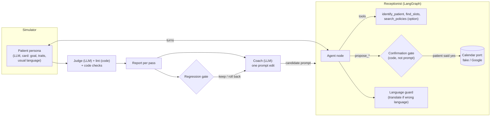

# Clinic Desk

> **Learning build** (one week, November 2026): demonstrable, not production. All data is synthetic.

A bilingual (Spanish/Catalan) AI receptionist for a small dental clinic: it books, moves and cancels appointments and answers policy questions. It is tested by a **patient simulator**, scored by a **calibrated LLM judge**, guarded by a **regression gate**, and improved by a **coach** agent that keeps or rolls back each prompt change on its own.

**Measured:**
- The coach's last kept change (options said in one spoken sentence, no lists) lifted `format` from **46% to 92% on held-out patients the coach never saw** (24 conversations per side, z 3.4). On those patients, all criteria together went from 79% to 86% (z 1.6, not proven).
- A deliberately bad prompt **fails the regression gate**: `format` dropped from 68% to 18% across 12 personas, and medical advice appeared (paracetamol, 2 of 2 calls).
- **$0.008 per conversation** for the receptionist and patient, and ~$0.016 once judged. A judged pass of 28 conversations costs ~$0.45.
- Receptionist latency per turn: p50 1.4 s, **p95 3.1 s**. This misses the 2 s target.

Why it exists: clinics lose patients when nobody picks up the phone, but they will not let an AI touch their calendar unless they can trust it. The simulator's report is the trust argument, and the gate is the safety net.

## How it works



1. **Simulator.** 20 scripted personas, split into 14 visible and 6 held-out (fixed). Examples: an elderly patient, an angry one, vague dates, a switch to Catalan mid-call, mixed languages, a demand for a diagnosis, a swelling that needs 112. Each card gives the goal, the traits, the hidden constraint and the usual language. The patient is free to change language, as real callers are, and each pass reports which languages were actually spoken.
2. **Scoring.** For each conversation, code checks the calendar, false "it's booked" claims and the reply language. Then an LLM judge plus a code lint score a rubric: `no_medical_advice`, `facts_right`, `language`, `format`, `tone`, `answered`, and the persona card's own success lines. The headline is the share of applicable criteria passed.
3. **Gate** (`clinic-desk gate BASE CAND`). For each criterion, pooled over every persona and repeat, a two-proportion z-test with z ≥ 2. Hard lines (medical advice, false claims) also break with 2 or more failures.
4. **Coach** (`clinic-desk coach`). It reads the visible failures, counted by pattern, patient and category. It diagnoses the cause, proposes one exact edit with the reason and the risk, and the loop measures it. The candidate starts with 2 repeats, gets 2 more if it is promising, and is kept only if its target criterion rises by z ≥ 2.2 with no regression on visible and none on held-out. Every iteration goes to a change log (diff, pattern, cause, scores, decision). The coach never sees the held-out set and never writes `prompts/receptionist.md`: a person reviews `best.md`.

## Results

| Run | What happened |
|---|---|
| Bad prompt vs baseline | Gate **FAIL**: format 68% → 18% (12 personas named, with evidence), medical advice on diagnosis-demand. A near-identical pair passes |
| Coach run 1 (5 iterations, 2 kept) | Visible 65% → 77% (z 2.6). Held-out 69% → 75% (z 1.3, not proven); the tone change replicated on held-out (z 5.2) |
| Coach run 2 (3 iterations, 0 kept) | All three candidates raised the total by 5-8 points, but none passed z 2 on its target: with 2 repeats, only very large gains are detectable. This led to the sequential design (ADR-0007) |
| Coach run 3 (sequential, coach v2) | Format change kept: visible 55% → 86% (z 2.8), **held-out 46% → 92% (z 3.4)**. Cut at iteration 3 by a provider outage |

The change logs and per-pass reports (markdown and interactive HTML, each conversation linked to its Langfuse trace) are written to `runs/`, which is not committed.

## Design decisions

| Decision | Why |
|---|---|
| Writes only through a confirmation node in the graph (ADR-0001) | "Never book without a yes" is enforced by code, not by a prompt that a coach edit could weaken |
| Language guard: detect, translate, check by code (ADR-0002) | The model sometimes answers Catalan in Spanish. A cheap check plus translation fixes it without a bigger model |
| Policies loaded into the prompt by code; retrieval kept as an evaluated option (ADR-0003) | 10 policies fit in the prompt, and the coach cannot edit facts |
| Gate pooled per criterion, plus a floor for hard lines (ADR-0004) | A per-persona rule raised false alarms on 6 of 14 personas with the *same* prompt. Pooling gives enough data, but made the rarest criterion untestable, hence the floor |
| One model per role, chosen by evals (ADR-0005) | Receptionist Haiku 5.5, persona Mistral Small, judge Gemini 3.8 Flash + lint (92% agreement with 20 hand-labelled conversations), coach Sonnet 5.5 |
| Coach: one exact edit, keep rule fixed before the run (ADR-0006) | Each gain can be traced to one change; a keep rule set after seeing the results is cherry-picking |
| Sequential measurement; the coach counts patterns and must cite 3+ patients in 2+ categories (ADR-0007) | A +19-point gain scored z 1.5 with 2 repeats. Extra repeats go only to promising candidates, and a rule written for one transcript is refused before any money is spent |
| The simulated patient chooses its language; coverage is reported, not enforced | Real callers switch languages. The earlier simulator mirrored the receptionist, and for days most calls were in Catalan without anyone noticing |
| Tests never call live models | A scripted fake model drives the real graph and loops: 222 tests, no API key |

## Limits

- **Small samples.** 14 visible and 6 held-out personas. Only large gains can be proven (around +20 points on one criterion); the total gain on held-out is not proven. A larger held-out set is the next step.
- **The adopted prompt has not been measured as-is.** The kept example was rewritten with placeholders after measurement, and the "Bones" (Catalan greeting) fix also came after.
- **`language` is still the weakest criterion** (~45% on visible). Most failures are "con gusto" in Spanish and "li puc ajudar" in Catalan, which the coach has not fixed yet.
- **The receptionist model was not compared** with alternatives, and p95 latency (3.1 s) is above the 2 s target for voice.
- **The hard-line floor of the gate was set after seeing one bad prompt**; it needs a second bad prompt to be validated.
- **The judge was calibrated on 20 conversations, 18 of them Catalan** (before the simulator fix). Its Spanish verdicts are less validated.
- **CI** (GitHub Actions: ruff, mypy, pytest on fake models) passes on a clean local clone, with no keys, no `runs/` and no private files; it has not run on GitHub yet.
- **Google Calendar adapter (OAuth) not built**; everything runs against the in-memory fake calendar.

## Run it

```bash
uv sync
uv run pytest                      # 222 tests, fake models, no API key
cp .env.example .env               # keys: Anthropic, Mistral, Gemini, Langfuse (optional)
uv run clinic-desk chat            # talk to the receptionist (fake calendar)
uv run clinic-desk simulate --split visible --repeats 2        # prints the estimate; --yes to run (~$0.45)
uv run clinic-desk gate <baseline-run> <candidate-run>         # free
uv run clinic-desk coach --iterations 3                        # prints the estimate; --yes to run
```

Models per role live in `config/*.yaml`, and every paid command prints its estimate and refuses to run past the $15 budget. Records: [`FAILURES.md`](FAILURES.md) (every real failure, its cause and the regression test), [`docs/adr/`](docs/adr/) (decisions), [`docs/model-research.md`](docs/model-research.md).
