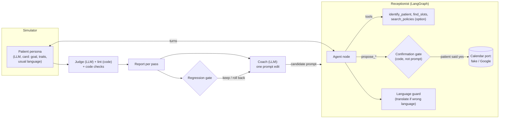

# Clinic Desk

> **Learning build**: one week (9-15 Nov 2026), ~20 hours, a $15 API budget. Demonstrable, not production. All data is synthetic.

An AI phone receptionist for a small dental clinic in Barcelona that speaks Spanish and Catalan. It books, moves and cancels appointments and answers questions about the clinic. Around it sits the real subject of the project: **a way to measure whether it is good enough, and to improve it safely**.

## In one minute

- **The problem.** Small clinics lose patients when nobody picks up the phone. An AI could answer, but a clinic will not let it touch the calendar unless it can trust it: no booking without a "yes", no medical advice, the right language, the right facts.
- **What was built.**
  - The **receptionist**: an agent with tools over the clinic's calendar. A confirmation step written in code means it cannot book anything without the patient's "yes".
  - A **patient simulator**: 20 fictional patients played by an LLM (elderly, angry, vague about dates, switching to Catalan, asking for a diagnosis…).
  - A **judge** that scores every call against a rubric: an LLM checked against hand labels, plus rules in code.
  - A **regression gate** that blocks a prompt change that makes things worse.
  - A **coach**: an agent that reads the failed calls, proposes one change to the receptionist's instructions, measures it on fresh calls, and keeps it or rolls it back on its own.
- **The headline result.** The coach found that the receptionist read appointment options as numbered lists, which sounds wrong on the phone. It changed the instructions and **proved the fix on patients it had never seen**: `format` went from 46% to 92% (24 calls per side, z 3.4). A deliberately harmful prompt is stopped by the gate, which names the patients it hurt and why.
- **What it costs.** About **$0.008 per simulated call** ($0.016 once judged); a full judged test pass of 28 calls costs ~$0.45.

## Results

| What | Result |
|---|---|
| Coach, best run | Kept a change that lifted `format` from 55% to 86% on the 14 visible patients and **from 46% to 92% on the 6 held-out patients** (z 3.4). All criteria on held-out: 79% → 86% (z 1.6, not proven) |
| Coach, first run | Visible score 65% → 77% (z 2.6). The tone change replicated on held-out (z 5.2) |
| Bad prompt #1 (medicines + numbered lists) | Gate **FAIL**: format 68% → 18% across 12 patients, and medical advice (paracetamol, 2 of 2 calls) |
| Bad prompt #2 (home-care tips and triage only, no lists) | Gate **FAIL**: medical advice in 6 of 7 calls that touched symptoms (z 3.1), in Spanish and Catalan ("enjuagarse con agua tibia con sal"), across 3 patients |
| Current prompt (coach's change + hand fixes) vs the coach's winner | Gate PASS. `language` 32% → 70% (z 2.8); all criteria 82% → **89%** |
| Latency per turn | p50 1.3-1.4 s, **p95 3.1-3.3 s**: above the 2 s a voice call needs |
| Real calendar | Booked and moved real events on a Google test calendar, through the same confirmation step |

## How it works



1. **Simulate.** Each fictional patient has a card: what they want, how they behave, what they keep back, and the language they usually speak. 14 patients are *visible* (the coach learns from them) and 6 are *held out* (only used to check that a change generalises). Patients may switch language, as real callers do, and each pass reports which languages were actually spoken.
2. **Score.** Code checks the calendar, any "it's booked" said before it was, and the reply language. Then the judge scores the rubric: no medical advice, facts right, language quality, phone-friendly format, tone, every question answered, and the patient card's own goals. The headline number is the share of criteria passed.
3. **Gate.** Two passes are compared criterion by criterion, pooling every patient and repeat, with a statistical test (two-proportion z-test, z ≥ 2). The hard lines (medical advice, false claims) also fail on 2 or more cases, because they are too rare for statistics.
4. **Coach.** It reads the visible failures counted by pattern, diagnoses the cause, and proposes one exact edit with its reason and risk. The edit is kept only by a rule fixed *before* the run: the target criterion must rise beyond the noise, with no regression on visible or held-out patients. Every attempt goes to a change log. The coach never sees the held-out patients and never edits the live prompt: a person reviews its best version.

## Decisions that were questioned along the way

The most useful part of the week was the decisions that turned out to be wrong and had to change.

| First approach | What showed it was wrong | What replaced it |
|---|---|---|
| Gate per patient: a patient "breaks" if its score drops | Two passes of the **same** prompt "broke" 6 of 14 patients: with 2 calls each, one flip is 50 points | Pool every patient per criterion and test the difference statistically (ADR-0004) |
| Pooled test for everything | It missed medical advice in 2 of 4 calls: the most important criterion has the least data | A floor for hard lines: 2+ cases fail the gate. It was set after seeing that one bad prompt. A second one (home-care tips only) was stopped too, but at 6 of 7 calls the test alone would also have caught it, so the floor's own value still rests on one case. Good changes have not tripped it |
| The receptionist greets in Catalan, and the patient's language comes from its card | For days most calls were in Catalan: the LLM playing Spanish patients copied the receptionist. Nobody had looked | Greet in Spain Spanish and follow the patient. The patient chooses its language freely, as people do, and **coverage is measured**, not enforced (forcing it was tried and rejected) |
| Coach keep rule with 2 repeats per candidate | All 3 candidates of a run improved the total, yet none passed: a real +19-point gain scored z 1.5. Too few calls to see medium gains | Sequential measurement: more repeats only for promising candidates, with a slightly stricter bar to pay for the second look (ADR-0007) |
| Coach reads the failures grouped by criterion | It skipped the biggest pattern ("con gusto" in 7 of 7 Spanish failures) and repeated a prohibition that was not working | Failures counted by pattern, cause diagnosed first, instructions in positive form, and each change must cover 3+ patients in 2+ categories (code-checked against overfitting) |
| Examples inside the prompt | The receptionist copies examples word for word: a feminine "la pugui ajudar" said to men, real times copied as if they were free slots, "el viernes… el viernes… el viernes" | Examples use placeholders and gender-free wording, and the coach is told so |

## Design decisions

| Decision | Why |
|---|---|
| Writes only through a confirmation node in the graph (ADR-0001) | "Never book without a yes" is enforced by code, so no prompt change can weaken it |
| Language guard: detect, translate, check by code (ADR-0002) | The model sometimes answers a Catalan patient in Spanish. A cheap check plus translation fixes it without a bigger model |
| Clinic policies loaded into the prompt by code (ADR-0003) | 10 policies fit in the prompt, facts stay out of the model's memory, and the coach cannot edit them |
| One model per role, chosen by evals (ADR-0005) | Receptionist Claude Haiku 5.5, patients Mistral Small, judge Gemini 3.8 Flash + lint (92% agreement with 20 hand-labelled calls), coach Claude Sonnet 5.5. Cheap where it can be, stronger only where it pays |
| One exact edit per coach iteration, keep rule fixed before the run (ADR-0006) | Each gain can be traced to one change. A rule set after seeing the results is cherry-picking |
| Calendar as a port: simulations on an in-memory calendar, Google Calendar for the demo (ADR-0008) | Simulations stay free, fast and repeatable. The Google adapter (hand-written OAuth with PKCE) passes the same contract tests |
| A hard budget in code | Every paid command prints its estimate first and refuses to run past $15. Chats count too |
| Tests never call live models | A scripted fake model drives the real graph and loops: 242 tests, no API key, run in CI |

## Limits

- **Small samples, on a $15 budget, on purpose.** Each judged pass costs ~$0.45, so every measurement traded evidence for money: 14 visible and 6 held-out patients, 2-4 repeats. Only large gains can be proven (around +20 points on one criterion); the total gain on held-out is not. With no cap, each change could be measured alone on many more calls. The aim was to iterate fast and find a quality/price balance for a proof of concept.
- **`language` is still the weakest criterion** (70% on visible, up from 32%). "Con gusto" survives in the first reply of 4 of 12 Spanish calls, even with a positive instruction; the rest are one-off Catalan slips.
- **The receptionist model was not compared** with alternatives, and p95 latency (3.1-3.3 s) is above the 2 s target for voice.
- **The judge was calibrated on 20 calls, 18 of them in Catalan** (before the simulator fix). Its Spanish verdicts are less validated.

## If a real clinic were to use it

What would come next, roughly in order:

1. **Real calls, not text.** Speech-to-text and text-to-speech around the same graph, and a faster receptionist: p95 must drop from 3.1 s to under 2 s. Compare 2-3 cheaper or faster models with the gate (one pass each) and stream the replies.
2. **Health data and privacy.** Patients mention symptoms, which is special-category data under GDPR: EU hosting, a data-processing agreement with each provider, short retention, and no patient data in traces. Today everything is synthetic.
3. **A human in the loop.** Transfer to the clinic's staff when the agent hands off, and a daily summary of what it booked or could not handle.
4. **Evals from real calls.** Sample real (anonymised) calls, judge them offline, and turn the failures into new simulated patients, so the test set follows reality. Grow the held-out set to ~10 patients and recalibrate the judge on Spanish.
5. **Per-clinic setup.** Each clinic's hours, staff, services and policies come from its own data files. The Google app must pass Google's verification, with one OAuth connection per clinic.
6. **Run the coach on a schedule**, with a person approving each change before it goes live, as today.

## Potential improvements to the method

- Paired comparisons (the same patient script on both prompts) to get more statistical power from the same number of calls.
- Let the coach propose 2-3 candidates per iteration and test them together.
- Batch the judge (cheaper) and cache the long fixed prompt (cheaper, faster).
- Validate the hard-line floor on more bad prompts and track its false-alarm rate on good changes.

## Run it

```bash
uv sync
uv run pytest                      # 242 tests, fake models, no API key
cp .env.example .env               # keys: Anthropic, Mistral, Gemini, Langfuse (optional)
uv run clinic-desk chat            # talk to the receptionist (fake calendar)
uv run clinic-desk calendar-auth   # Google OAuth consent (a dedicated test calendar only)
uv run clinic-desk chat --calendar google   # the same receptionist on the test calendar
uv run clinic-desk simulate --split visible --repeats 2        # prints the estimate; --yes to run (~$0.45)
uv run clinic-desk gate <baseline-run> <candidate-run>         # free
uv run clinic-desk coach --iterations 3                        # prints the estimate; --yes to run
```

## Where to look

| Path | What it holds |
|---|---|
| [`prompts/receptionist.md`](prompts/receptionist.md) | The receptionist's instructions: the only thing the coach may change |
| [`prompts/coach.md`](prompts/coach.md) | How the coach chooses and writes a change |
| [`FAILURES.md`](FAILURES.md) | Every real failure: symptom, how it was found, root cause, fix, regression test. A third of them were in the test harness, not the receptionist |
| [`docs/adr/`](docs/adr/) | One page per lasting decision, with the alternatives |
| [`docs/model-research.md`](docs/model-research.md) | Model candidates per role, with prices |
| `src/clinic_desk/` | `receptionist/` (the graph), `scheduling/` (calendar port, fake and Google), `simulator/` (personas, judge, gate, reports), `coach/` (the loop) |
| `data/clinic/`, `data/personas/` | The fictional clinic (hours, staff, services, policies, patients) and the 20 simulated patients, with the visible/held-out split |
| `data/eval/`, `evals/regression/` | The judge's hand labels; the bad prompts used to test the gate |
